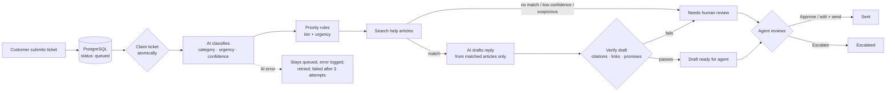

# Triage Desk — AI support triage with human approval

A customer submits a support ticket. AI labels it and drafts a reply using **only the company's own help
articles**. A human support agent reviews and approves the reply before anything is sent.

> **Portfolio demo.** "Fernway", its customers and its help articles are fictional. No real customer data is
> used, and no time- or cost-saving figures are claimed.

**Status:** Phase 2 of 3 complete — the triage engine, customer ticket form, agent dashboard (review, edit,
approve, escalate, retry) and stats bar are built and tested. Phase 3 (accuracy report, semantic search,
end-to-end tests in CI, deployment) is next.

## How it works



Every step writes to an append-only audit log.

## Safeguards

| Safeguard | How it's enforced | Tested in |
| --- | --- | --- |
| **Never auto-send** | The pipeline can only create *drafts*. The only code path that sends is an agent's **Approve** action: one transaction that succeeds only while the ticket is still sendable, backed by a unique index allowing one sent message per ticket — so double clicks or two agents racing can't send twice. | `tests/agent-actions.test.ts` |
| **No duplicate drafts** | Tickets are claimed with a single atomic `UPDATE … WHERE status='queued' RETURNING`, and a partial unique index (`drafts_one_pending_per_ticket`) makes a second pending draft impossible at the database level. | `tests/pipeline.test.ts` |
| **No invented policies** | No matching article → no draft. The AI must cite the articles it used; citations must be among the retrieved ones; any link, domain or email not in those articles is rejected; the model can declare "insufficient context". | `tests/pipeline.test.ts`, `guards.test.ts` |
| **Untrusted input** | Ticket text sits inside a randomly named tag that it cannot close, the system prompt marks it as data, the model has no tools, and output must match a strict schema. An independent rule-based detector flags injection attempts even if the model is fooled. Drafts that claim an action was taken ("refund approved") are rejected. | `tests/pipeline.test.ts`, `prompts.test.ts` |
| **Safe failure** | AI errors, timeouts and malformed output leave the ticket queued with the error logged; it's retried automatically up to 3 times, then marked failed and can be retried manually. | `tests/pipeline.test.ts` |
| **Audit trail** | Every AI action and agent decision (approve, edit, escalate, retry, sign-in) is recorded with actor, timestamp and details, and shown as a timeline on each ticket. | `tests/pipeline.test.ts`, `tests/agent-actions.test.ts` |

## Agent dashboard

`/dashboard` is one screen for the support team:

- **Stats bar:** tickets triaged, % routed to a person, average time to draft, % of AI drafts sent without
  edits, and AI usage (or cost, if you set `AI_PRICE_*`) per ticket.
- **Queue** sorted by fixed priority rules (urgency + plan tier), with status tabs.
- **Ticket view:** the customer's message, the AI's labels with its reason, the draft with the help articles
  it cites (expandable for checking), and a full activity timeline.
- **Actions:** Approve & send, Edit then send (edits are tracked against the original AI text), write a reply
  by hand (for tickets routed to a person, or while the AI is down), Escalate with a note, Retry triage.
- Pages update themselves while tickets are being triaged in the background (polling, no websockets).

**Sign-in:** pick a fictional agent ("acting as"). Sessions are HMAC-signed, httpOnly cookies that expire after
8 hours. Set `AGENT_PASSCODE` on any public deployment so strangers can't approve replies; failed attempts are
rate-limited and logged. The proxy redirect is only a fast path — every page and Server Action re-verifies the
session itself.

### Application security

- **Strict Content Security Policy** with a per-request nonce (`src/proxy.ts`): only scripts the app ships can
  run. Plus `X-Frame-Options`, `nosniff`, `Referrer-Policy`, `Permissions-Policy` and HSTS in production.
- **Validation everywhere:** one zod schema validates the form in the browser and again on the server, with
  control and bidi-override characters stripped. Every AI response is schema-validated before use.
- **Abuse protection:** per-IP rate limiting (IPs are stored only as an HMAC, never raw), a honeypot field,
  and Next.js Server Actions' built-in same-origin check against CSRF.
- **Agent sessions:** signed, httpOnly, `SameSite=Lax` cookies; optional passcode compared in constant time;
  sign-in redirects only back into `/dashboard` (no open redirects).
- **Secrets** live only in server-side environment variables, validated at startup; error messages name a
  bad variable but never echo its value. AI errors shown to agents are sanitised.
- **Parameterised SQL** throughout (Drizzle ORM); no raw string interpolation.

## Tech stack

Next.js 16 (App Router, Server Actions) · TypeScript · PostgreSQL · Drizzle ORM · Google Gemini (structured
output) · zod · Tailwind CSS + shadcn/ui · Vitest · PGlite (embedded Postgres for local dev and tests)

## Getting started

**Prerequisites:** Node.js 22 or newer. No Docker or Postgres install needed.

```bash
npm install
cp .env.example .env.local
# Put a random value in APP_SECRET:  openssl rand -hex 32

npm run db:local      # terminal 1 — starts an embedded Postgres on port 5433 (data in .data/)

npm run db:migrate    # terminal 2 — create tables
npm run db:seed       # 8 help articles + 10 sample tickets
npm run queue:process # triage the sample tickets
npm run triage:status # see the results in a table
npm run dev           # http://localhost:3000 — the agent dashboard is at /dashboard
```

By default the app uses a **mock AI provider** — deterministic keyword rules that run offline, so everything
works without an API key. It is labelled `mock-rules-v1` wherever it appears.

### Use Google Gemini

In `.env.local`:

```bash
AI_PROVIDER=gemini
GEMINI_API_KEY=your-key            # from https://aistudio.google.com
GEMINI_MODEL=gemini-3.5-flash-lite # fast and reliable on the free tier; see https://ai.google.dev/gemini-api/docs/models
AI_MAX_RPM=12                      # stay under the free tier's 15 requests/minute
```

### Use a hosted database

Replace `DATABASE_URL` with any Postgres 15+ connection string (for example a free Neon project), then run
`npm run db:migrate` and `npm run db:seed`.

## Try the failure cases

| Case | How to see it |
| --- | --- |
| No matching help article | Submit the "Compliance question" sample → in the dashboard it's **Needs review** ("No help article matches this question"), with no draft and a box to reply by hand. |
| Prompt injection | Submit the "Prompt-injection attempt" sample → a red **Hidden instructions detected** banner, no draft. |
| AI service failure | Set `AI_FORCE_FAIL=true`, restart, submit a ticket → it shows **Retry pending** with the error, and the agent can still reply by hand. Set it back to `false`, restart, click **Retry triage** → it becomes **Draft ready**. |

## Scripts

| Command | What it does |
| --- | --- |
| `npm run dev` / `build` / `start` | Next.js development server / production build / production server |
| `npm run check` | Typecheck, lint and run all tests |
| `npm test` | Unit and integration tests (in-memory Postgres; no setup needed) |
| `npm run db:local` | Embedded Postgres server on port 5433 |
| `npm run db:generate` / `db:migrate` | Create a migration from the schema / apply migrations |
| `npm run db:seed` / `db:reset` | Load sample data / wipe all tickets and reload (refuses in production) |
| `npm run queue:process` | Triage all queued tickets |
| `npm run triage:status` | Print the queue, highest priority first, with expected outcomes for sample tickets |

`POST /api/jobs/process-queue` processes the queue for a scheduler such as Vercel Cron. It's disabled unless
`CRON_SECRET` is set and requires `Authorization: Bearer <CRON_SECRET>`.

## Project structure

```
data/                    Fictional help articles and sample tickets
drizzle/                 SQL migrations
scripts/                 CLI: seed, process queue, status
src/app/                 Pages, Server Actions and API routes (dashboard/, agent/sign-in/, submit/)
src/components/          UI (shadcn/ui-based)
src/lib/ai/              AI provider interface, Gemini and mock implementations
src/lib/kb/              Help-article search (Postgres full-text search)
src/lib/triage/          Pipeline, prompts, output schemas, safety checks, priority rules
src/lib/tickets/         Ticket validation, intake, rate limiting and agent actions (approve, escalate)
src/lib/auth/            Signed agent sessions
src/lib/dashboard/       Dashboard queries and stats
src/proxy.ts             Per-request Content Security Policy
tests/                   Integration tests against a real (in-memory) Postgres
```

## Roadmap

- ~~**Phase 2 — Agent workflow:** dashboard, Edit / Approve / Escalate / Retry, audit timeline, stats bar.~~ ✅
- **Phase 3 — Hardening and launch:** end-to-end tests in the repo, pgvector semantic search, an accuracy
  report on 30–50 labelled fake tickets (including confidence calibration — the model currently reports ~1.0
  for almost everything), deployment, helpdesk webhook (stretch).
