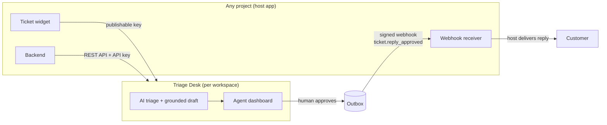

# Prompt pack: turn Triage Desk into a service any project can integrate

These prompts take Triage Desk from a standalone demo to a **multi-tenant triage service** that other projects
plug into. Paste them to your AI coding assistant **one at a time, in order**. Each step leaves the app working and tested,
and ends with a summary for you to review before running the next.

## Where we're heading

- Each integrating project becomes a **workspace** with its own help articles, categories, plan tiers,
  branding, API keys and webhooks.
- Host apps send tickets in through any of:
  - a **REST API** (server to server, API key)
  - an **embeddable ticket widget** (script tag or iframe, publishable key)
  - **helpdesk webhooks** (Zendesk / Freshdesk, optional)
- Results go back as **signed webhooks** (`ticket.draft_ready`, `ticket.reply_approved`, …). The host app
  delivers the approved reply itself, by email or in-app. Triage Desk **still never sends anything without a
  human clicking Approve**.
- Agents use the Triage Desk dashboard, either standalone or embedded in the host's admin panel.
- It ships as a Docker image with a worker, a TypeScript SDK and an example host app.



**Suggested order:** steps 1–3 first, because everything else builds on them. Steps 4–6 make it usable as a
service, 7–8 add embedding, 9 is optional, and 10–12 prepare it for shipping. Steps 2, 5, 6 and 7 are the
largest.

---

## Session starter: paste this first in every new session

```
We're evolving Triage Desk (this repo) from a standalone demo into a multi-tenant triage service that any
project can integrate (REST API, embeddable widget, signed webhooks, SDK). The plan is in
docs/integration-prompts.md; we're on step <N>.

Before coding: read README.md, AGENTS.md (Next.js 16 — check node_modules/next/dist/docs before using any
Next.js API) and everything in docs/adr/.

Non-negotiables for every step:
- Keep every existing safeguard: never auto-send (only a human Approve releases a reply), no duplicate
  drafts, no invented policies, untrusted input stays data, safe failure + retry, full audit trail.
- Tenant isolation: no code path may read or write another workspace's data. Every new table has
  workspace_id and every query filters by it. Add a test proving isolation for anything new.
- Security: validate all input with zod, hash secrets at rest, use constant-time comparisons, and never put
  secrets or customer PII in logs or error messages.
- Leave the app working: write a migration for every schema change, run `npm run check`, add or adjust
  tests, and update README.md and .env.example.
- Don't commit unless I ask. Finish with: what changed, what you verified and how, and anything left open.
```

---

## Step 1: Integration architecture (design only)

```
Step 1 — Integration architecture. Design only, no code.

Write docs/adr/0001-integration-architecture.md proposing how Triage Desk becomes a service other projects
integrate with. Cover:
1. Tenancy: a `workspaces` table, which tables get workspace_id, ticket numbering (global vs per
   workspace), and how the existing Fernway demo data maps to a default workspace. Say whether to add
   Postgres row-level security as a second line of defence.
2. Per-workspace settings: company name, reply sign-off, categories (key, label, definition the AI sees),
   plan tiers with priority weights, thresholds, AI model.
3. Integration surfaces: REST API v1 (resources, API-key auth and scopes, idempotency, pagination, error
   format), embeddable widget (publishable key, allowed origins), inbound helpdesk webhooks, outbound signed
   webhooks (event list and payload shape).
4. Sending: approved replies are handed to the host app via a `ticket.reply_approved` webhook (or read
   through the API). Triage Desk itself never emails anyone.
5. Agent access: standalone login vs. embedded in a host admin panel using short-lived host-signed tokens.
   Roles limited to admin and agent.
6. Background work: a worker process using FOR UPDATE SKIP LOCKED, keeping after() as a fast path.
7. Packaging: Docker image + docker-compose, SDK package, example host app.
8. Rollout order, main risks (tenant data leaks, SSRF via webhook URLs, leaked keys) and what stays out of
   scope.

Include a mermaid diagram and a decisions table with the alternatives you considered. Stop after writing it
and list the decisions you want me to confirm.
```

## Step 2: Multi-tenancy foundation

```
Step 2 — Multi-tenancy foundation, following docs/adr/0001.

- Add a `workspaces` table and a non-null, indexed workspace_id foreign key to tickets, kb_articles, drafts,
  messages and audit_events. The migration backfills existing rows into a "fernway-demo" workspace.
- Make uniqueness per workspace where it matters (e.g. kb_articles.slug; ticket numbers as decided in the ADR).
- Thread the workspace through the domain layer: pipeline, KB search, intake, agent actions, dashboard
  queries and stats all take a workspaceId and filter by it. Structure it so forgetting the filter is hard
  (e.g. workspace-scoped repository functions). Add row-level security too if the ADR chose it.
- The seed script creates the demo workspace, and the current UI keeps working against it.
- Tests: an isolation suite with two workspaces proving that tickets, drafts, articles, stats, audit events,
  KB search and the queue processor never cross over.

Done when all existing tests pass, the isolation tests pass, and the demo behaves exactly as before.
```

## Step 3: Per-workspace configuration

```
Step 3 — Per-workspace configuration.

Today the company name (Fernway), the 7 categories, the 3 tiers and their weights, the reply sign-off and the
thresholds are hard-coded (src/lib/domain.ts, src/lib/triage/prompts.ts, src/lib/triage/priority.ts,
src/lib/env.ts). Make them workspace settings:
- A versioned, zod-validated settings document per workspace: company/product name, reply sign-off, tone
  notes, categories [{key, label, definition}], tiers [{key, label, weight}], urgency weights (the four
  urgency levels stay fixed), min confidence, KB min score. Current env values become defaults.
- category and tier can no longer be Postgres enums. Migrate them to text, validated against the
  workspace's settings when written. Fernway keeps its current values.
- Build the classification prompt and its JSON schema from the workspace's categories, and the draft prompt
  from its company name and sign-off. The prompt-injection protections must stay exactly as strong.
- Dashboard labels and badges come from settings; unknown keys fall back gracefully.
- An admin settings page with inline validation errors (admin-only once step 7 exists).

Tests: a second workspace with different categories and tiers is classified, prioritised and drafted using
its own settings (mock provider), and its prompts never mention Fernway.
```

## Step 4: Help-centre management

```
Step 4 — Help-centre management per workspace.

- Service functions to create, update, delete and bulk-upsert articles (by slug or external id), with
  validation and size limits.
- Admin UI: list and search, create and edit (markdown with preview), delete, and import from JSON or a zip
  of markdown files (frontmatter: title, category, keywords).
- Audit every change. Search indexing stays automatic; keep the design ready for embeddings (pgvector) later.
- Articles are trusted company content, but still strip control characters and keep the prompt's article
  delimiters impossible to forge from article text.
- Tests: CRUD, imports (valid and malformed files), workspace isolation, and that new drafts use updated
  content after an article is edited.
```

## Step 5: API keys and REST API v1

```
Step 5 — Public REST API v1.

- API keys per workspace: create, list, revoke and rotate in settings. Show the full key once (e.g.
  `td_live_<random>`), store only a hash plus a short display prefix, record last_used_at. Scopes:
  tickets:read, tickets:write, kb:read, kb:write.
- Endpoints under /api/v1 (JSON, one consistent error shape, cursor pagination):
  - POST /tickets: subject, body, customer {name, email, external_id}, tier, metadata, optional
    external_ticket_id. Supports an Idempotency-Key header. Returns 202 with id, number and status, and
    starts triage.
  - GET /tickets/:id and GET /tickets?status=&updated_since=: triage result, review reasons, draft (on
    request) and the approved reply.
  - POST /tickets/:id/retry
  - GET/PUT/DELETE /kb/articles[/:id] and POST /kb/articles:bulk
- Auth with `Authorization: Bearer <key>`, per-key rate limits stored in Postgres, every call audited as actor
  "api-key:<prefix>", and `Cache-Control: no-store` on every response.
- Generate an OpenAPI 3.1 document from the zod schemas, serve it at /api/v1/openapi.json and add a readable
  reference page.
- Tests: missing, revoked, wrong-scope and other-workspace keys; validation errors; idempotency (same key and
  body → same ticket, same key with a different body → 409); pagination; rate limiting.
```

## Step 6: Signed webhooks and reply hand-off

```
Step 6 — Signed outbound webhooks and reply hand-off.

- Workspaces register webhook endpoints: URL, subscribed events, and a secret shown once. Events:
  ticket.created, ticket.triaged, ticket.draft_ready, ticket.needs_review, ticket.failed,
  ticket.reply_approved, ticket.escalated.
- Transactional outbox: the event row is written in the same transaction as the state change, then the
  worker delivers it with exponential backoff and a dead-letter state after max attempts. Delivery is
  at-least-once; every event has an id so receivers can de-duplicate.
- Signing: a header with a timestamp and an HMAC-SHA256 of `timestamp.body` using the endpoint's secret.
  Document how receivers verify it, with a 5-minute replay window.
- SSRF protection: https only in production. Resolve the host and refuse private, loopback, link-local and
  cloud-metadata addresses, checking again at delivery time and not only at registration. Short timeouts,
  no redirects.
- ticket.reply_approved carries the final reply and the customer details so the host app can deliver it.
  In the dashboard, "Approve & send" becomes "Approve & hand off", with clear wording about what happens.
  The never-auto-send rule doesn't change.
- Settings UI: endpoint list, "send test event", recent deliveries with status and response code, manual
  redelivery.
- Tests: signing and verification, retries and dead-lettering against a fake receiver, outbox atomicity (no
  event if the transaction rolls back), SSRF blocklist cases.
```

## Step 7: Agent accounts and embedded access

```
Step 7 — Agent accounts and access.

Replace the demo "acting as" sign-in with real accounts, keeping a demo mode for the portfolio site:
- workspace_members (user, workspace, role admin|agent). Admins manage settings, keys, webhooks and members;
  agents work tickets. Enforce roles in every Server Action and API route, not only in the UI.
- Standalone sign-in with email and password using a well-maintained library: argon2id hashing,
  rate-limited attempts, generic error messages, httpOnly session cookies, "sign out everywhere".
- Embedded mode: the host app's backend signs a short-lived token (workspace, external user id, name, role,
  expiry ≤ 5 minutes) with a per-workspace secret, and Triage Desk exchanges it for a session. Document the
  flow with a code sample.
- Demo mode: an env flag keeps today's fictional agents, for the public demo only.
- Tests: role checks on every action and route, token signature, expiry and replay, and a member of
  workspace A can't open workspace B's tickets even with a guessed id.
```

## Step 8: Embeddable ticket widget

```
Step 8 — Embeddable customer ticket form.

- A per-workspace publishable key (safe to expose; it can only create tickets) and an allowed-origins list.
- Two ways to embed: (a) a script tag that renders a button and form inside a shadow DOM, and (b) an iframe
  route /embed/<workspace>/new-ticket. Both reuse the existing validation, honeypot and rate limiting.
- CSP: the embed route sets frame-ancestors to the workspace's allowed origins (every other page keeps
  frame-ancestors 'none'), and the widget's API calls allow CORS only from those origins.
- The host can pre-fill known customer data. Tier and external ids are accepted only in a signed parameter,
  so customers can't upgrade themselves to Enterprise.
- Theming (primary colour, light/dark) from settings. Accessible: labels, focus trap, Esc to close.
- Tests: origin checks, tampered signed parameters, CSP headers per route, and a Playwright test that embeds
  the widget in a local test page.
```

## Step 9: Helpdesk adapters (optional)

```
Step 9 — Inbound helpdesk adapters (optional).

Turn Zendesk and Freshdesk webhooks into Triage Desk tickets in a workspace: verify each provider's
signature, map the fields, de-duplicate by external ticket id and record the source. Use the providers'
documented sample payloads as test fixtures. Describe this as "integration-ready — not tested against a live
account" unless I provide test accounts. Optionally post approved replies back through the provider's API
behind a feature flag that's off by default.
```

## Step 10: SDK, example host app and integration guide

```
Step 10 — SDK, example host app and integration guide.

- packages/sdk: a small typed TypeScript client (tickets, KB, and a webhook signature verification helper)
  with no runtime dependencies. Set up npm workspaces, unit tests and a README.
- examples/host-app: a tiny "other project" that creates tickets through the API, embeds the widget,
  receives and verifies webhooks, and "delivers" approved replies by logging them.
- docs/integration-guide.md: a 5-minute quick start (create workspace → API key → POST a ticket → receive
  the webhook), embedding the widget and the dashboard, KB import, security notes, curl examples, and a
  Python snippet for non-JavaScript projects.
- Link all of it from the README.
```

## Step 11: Run it anywhere

```
Step 11 — Packaging and operations.

- A dedicated worker (`npm run worker`) that claims queued tickets and outbox events with FOR UPDATE SKIP
  LOCKED, shuts down gracefully, and has configurable concurrency. Move the AI rate limit into Postgres so
  it's shared across processes instead of per process.
- A multi-stage Dockerfile (non-root user, Next.js standalone output) and docker-compose.yml (Postgres with
  pgvector, app, worker, and a one-off migration job).
- /api/health (liveness) and /api/ready (database reachable, migrations applied), plus structured JSON logs
  without PII.
- Document every environment variable and add a production checklist (secrets, passcode, HTTPS, backups,
  key rotation).
- Docker isn't installed on my machine: tell me exactly what you could and couldn't verify.
```

## Step 12: Security and integration review

```
Step 12 — Hardening pass.

Review the whole integration surface the way an attacker would: tenant isolation in every query, API auth
and scopes, guessable ids (IDOR), webhook SSRF and replay, widget origin checks and signed parameters, the
embed-token flow, rate limits, secrets at rest and in logs, CSP per route, and a dependency audit. Fix what
you find, add a regression test for each fix, and write docs/security.md summarising the threat model and
controls.

Finish with an end-to-end Playwright run: the example host app creates a ticket → the AI triages it → the
host receives the webhook → an agent edits and approves it in the embedded dashboard → the host receives
ticket.reply_approved.
```
